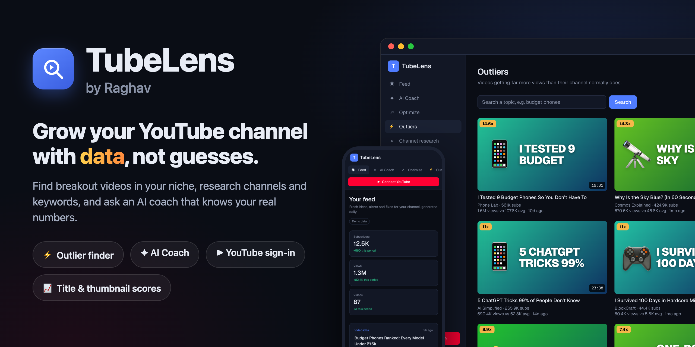
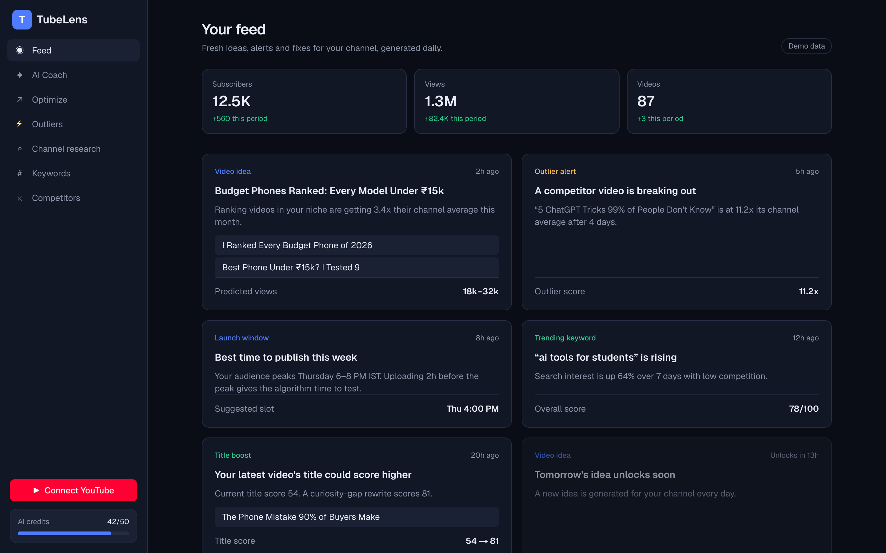
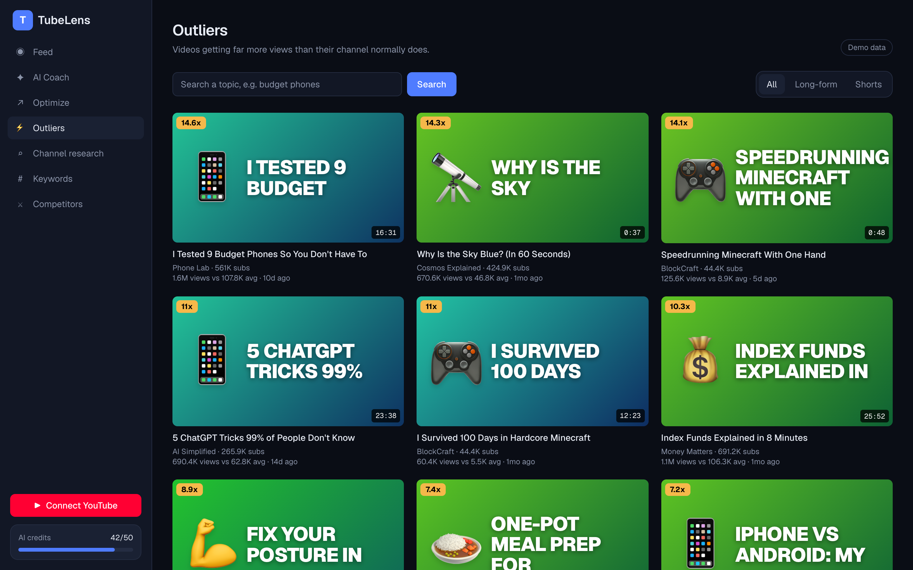
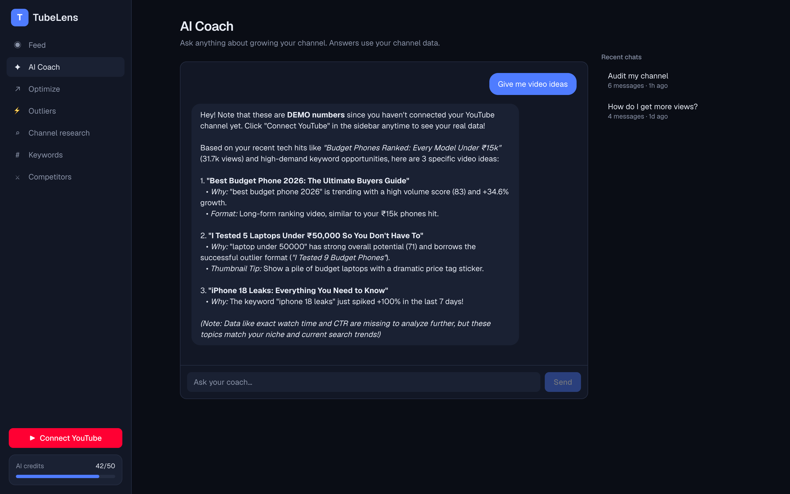
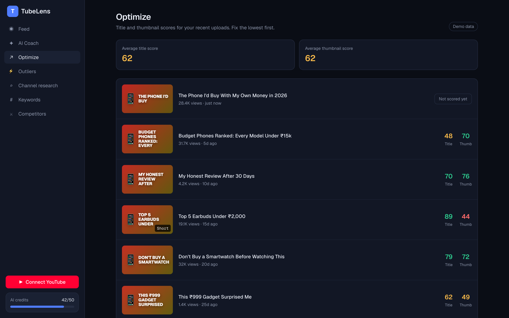
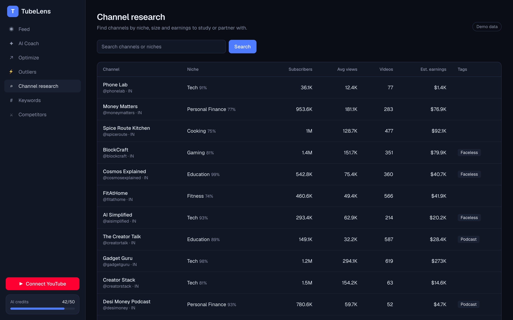
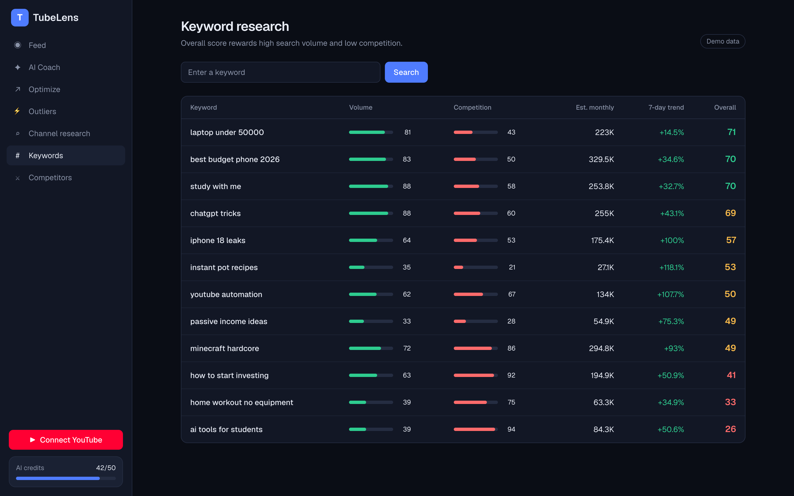
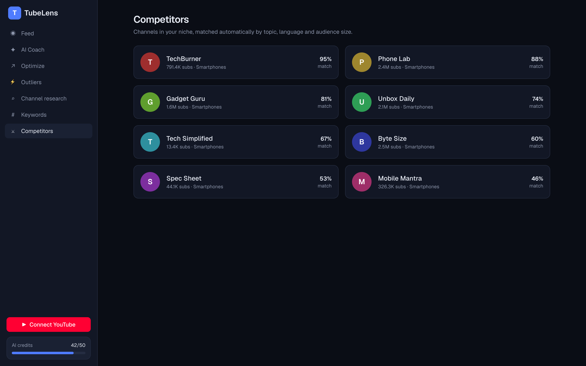
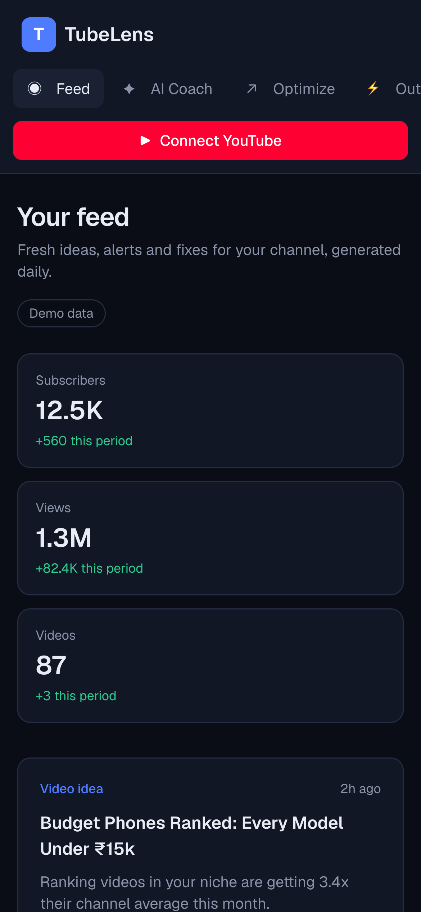

<p align="center">
  
</p>

<p align="center">
  
  
  
  
  
</p>

<p align="center">
  <b>TubeLens shows you what's working on YouTube right now, and what to make next.</b><br>
  Find breakout videos in your niche, research channels and keywords, and ask an AI coach that knows your real channel numbers.
</p>

<p align="center">
  <a href="#-features">Features</a> ·
  <a href="#-quick-start">Quick start</a> ·
  <a href="#-connect-your-accounts">Connect your accounts</a> ·
  <a href="#-how-it-works">How it works</a> ·
  <a href="#-roadmap">Roadmap</a> ·
  <a href="#-questions">Questions</a>
</p>

<p align="center">
  
</p>

## ✨ Features

<table>
<tr>
<td width="50%" valign="top">

### ⚡ Outliers
Videos getting **far more views than their channel normally does**: 14x, 20x, 25x their average. Search any topic, filter long-form or Shorts, and see exactly which formats are breaking out.

</td>
<td width="50%" valign="top">

### ✦ AI Coach
Ask anything about growing your channel. The coach reads your **real subscribers, views and latest uploads**, and answers with specific ideas. It even replies in Tenglish if you write in Tenglish.

</td>
</tr>
<tr>
<td></td>
<td></td>
</tr>
<tr>
<td width="50%" valign="top">

### ↗ Optimize
Your recent uploads in one list with **title and thumbnail scores**, so you know which videos to fix first. Connect YouTube and it lists your real videos and views (scores for real videos are on the [roadmap](#-roadmap)).

</td>
<td width="50%" valign="top">

### ⌕ Channel research
Find channels by niche, size and estimated earnings. Spot **faceless** and **podcast** channels to study or partner with.

</td>
</tr>
<tr>
<td></td>
<td></td>
</tr>
<tr>
<td width="50%" valign="top">

### # Keyword research
Search volume, competition and 7-day trend for each keyword, rolled into one **overall score**: high volume and low competition score highest.

</td>
<td width="50%" valign="top">

### ⚔ Competitors
Channels in your niche, matched by topic, language and audience size, with a match score.

</td>
</tr>
<tr>
<td></td>
<td></td>
</tr>
</table>

<table>
<tr>
<td width="30%"></td>
<td valign="middle">

### 📱 Works on your phone
The whole app adapts to small screens: the sidebar becomes a scrollable top bar, and cards stack into one column.

### ▶ Your own channel, read-only
**Connect YouTube** signs in with Google and reads your channel with read-only access. TubeLens can never post, edit or delete anything. Sign out at any time, and access is revoked at Google too.

</td>
</tr>
</table>

## 🚀 Quick start

You need **Node.js 22 or later**.

```bash
git clone https://github.com/raghavsunil99/tubelens.git
cd tubelens
npm install
npm run dev
```

Open **http://localhost:3000**. Every page works right away on built-in demo data; no keys needed.

To use real data, copy the example settings file and fill in the keys you want (each one is optional):

```bash
cp .env.example .env.local
```

## 🔑 Connect your accounts

| Key in `.env.local` | Turns on | Cost |
|---|---|---|
| `GEMINI_API_KEY` | Real AI Coach answers (Google Gemini) | Free tier |
| `GOOGLE_CLIENT_ID`, `GOOGLE_CLIENT_SECRET`, `SESSION_SECRET` | **Connect YouTube**: your real stats in Feed, Optimize and the Coach | Free |
| `YOUTUBE_API_KEY` | Live YouTube search in Outliers and Channel research | Free (daily quota) |

Restart `npm run dev` after changing `.env.local`.

<details>
<summary><b>🤖 AI Coach: get a free Gemini key</b></summary>

1. Open [Google AI Studio → API keys](https://aistudio.google.com/apikey) and click **Create API key**.
2. Add it to `.env.local`:
   ```
   GEMINI_API_KEY=your-key
   ```
3. Optional: `GEMINI_MODEL=gemini-3.8-flash` for smarter answers (the default is `gemini-3.5-flash-lite`; both have a free tier).

On the free tier, Google may use prompts to improve its products, and rate limits apply. Without a key the coach gives simple offline answers.

</details>

<details>
<summary><b>▶ Connect YouTube: Google sign-in</b></summary>

1. In [Google Cloud Console](https://console.cloud.google.com/), create a project and enable **YouTube Data API v3** and **YouTube Analytics API**.
2. Under **Google Auth Platform**, set up the consent screen (External), and add your Gmail under **Audience → Test users**.
3. **Clients → Create client → Web application**, with this authorized redirect URI:
   ```
   http://localhost:3000/api/auth/callback/google
   ```
4. Add the client ID and secret to `.env.local`, plus a random session secret:
   ```bash
   openssl rand -base64 32
   ```
   ```
   GOOGLE_CLIENT_ID=...apps.googleusercontent.com
   GOOGLE_CLIENT_SECRET=GOCSPX-...
   SESSION_SECRET=paste-the-random-value
   ```
5. Click **Connect YouTube** in the sidebar.

While the app is in *Testing* mode, only test users can sign in and logins expire after 7 days. Publishing to everyone requires Google's app verification.

</details>

<details>
<summary><b>🔎 Live search: YouTube Data API key</b></summary>

1. In the same Google Cloud project: **APIs & Services → Credentials → Create credentials → API key**.
2. Add it to `.env.local`:
   ```
   YOUTUBE_API_KEY=your-key
   ```

Each search uses about 100 units of the free 10,000-unit daily quota.

</details>

## 🧠 How it works

```
src/
  app/(app)/*        Pages: Feed, AI Coach, Optimize, Outliers, Research, Keywords, Competitors
  app/api/*          JSON routes the pages and future clients can call
  app/api/auth/*     Google sign-in, callback and sign-out
  lib/data.ts        Data layer: live data when keys are set, demo data otherwise
  lib/youtube.ts     YouTube Data API (public search)
  lib/youtube-user.ts  Your own channel, uploads and 28-day analytics (OAuth)
  lib/coach.ts       AI Coach: builds your channel context and streams Gemini answers
  lib/session.ts     Encrypted, httpOnly cookie session (AES-GCM)
  middleware.ts      Refreshes the Google access token before it expires
```

| Page | Demo data | With keys |
|---|---|---|
| Feed | ✅ | Real subscribers, views and videos, with 28-day change |
| AI Coach | Offline answers | Gemini answers grounded in your channel |
| Optimize | ✅ | Your latest 20 uploads |
| Outliers | ✅ | Live YouTube search, views ÷ channel average |
| Channel research | ✅ | Live channel search |
| Keywords | ✅ | Demo for now (see roadmap) |
| Competitors | ✅ | Demo for now (see roadmap) |

**Privacy:** your Google tokens live only in an encrypted cookie in your browser. There's no database and nothing is stored on a server. The AI Coach sends your channel stats and video titles to Gemini to answer your question.

## 🗺 Roadmap

- [ ] Real keyword search volume
- [ ] Title and thumbnail scoring model
- [ ] Daily feed cards generated for your channel
- [ ] Database for history, saved ideas and credits
- [ ] Automatic competitor matching
- [ ] Larger video index for Outliers

## ❓ Questions

**Do I need any keys to try it?**
No. Every page runs on demo data out of the box; a "Demo data" badge shows where.

**Is it free?**
Yes. The Gemini free tier, Google sign-in and the YouTube API daily quota are all free.

**"Google hasn't verified this app" when connecting YouTube.**
That's expected for your own test app. Click **Continue**. Only Gmail accounts you added as test users can sign in.

**The coach says the free Gemini quota is used up.**
Free-tier limits reset over time; wait a minute (or until the next day for the daily limit). You can see your limits in AI Studio under **Rate limits**.

**Can TubeLens change my YouTube channel?**
No. It only asks for read-only access.

---

<p align="center">
  Built by <b>Raghav</b> · An independent project, not affiliated with YouTube, Google or vidIQ.
</p>
